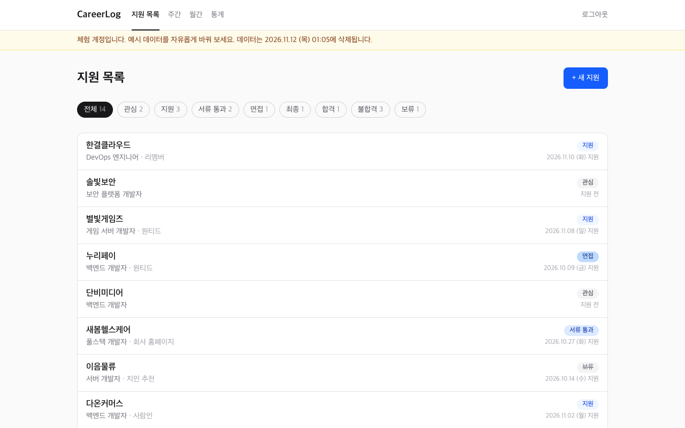
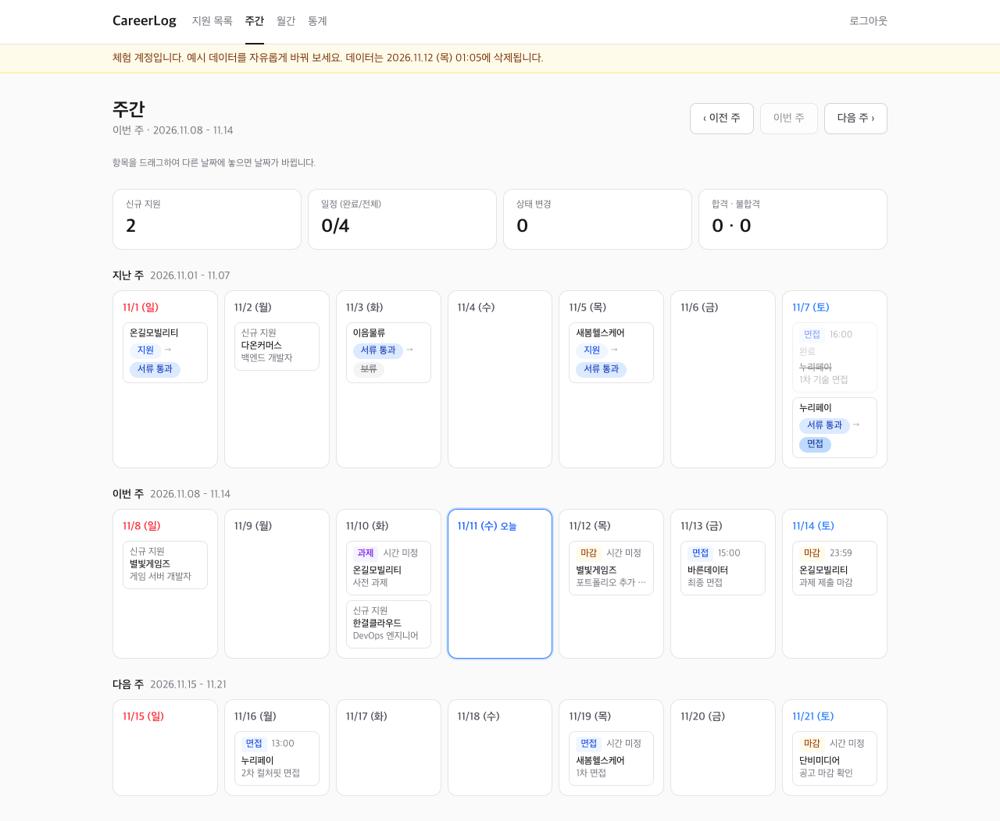
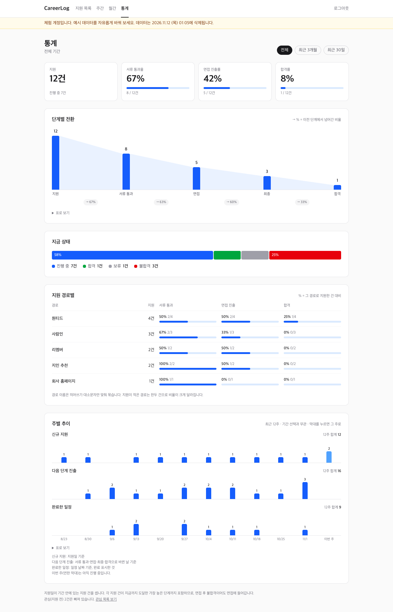
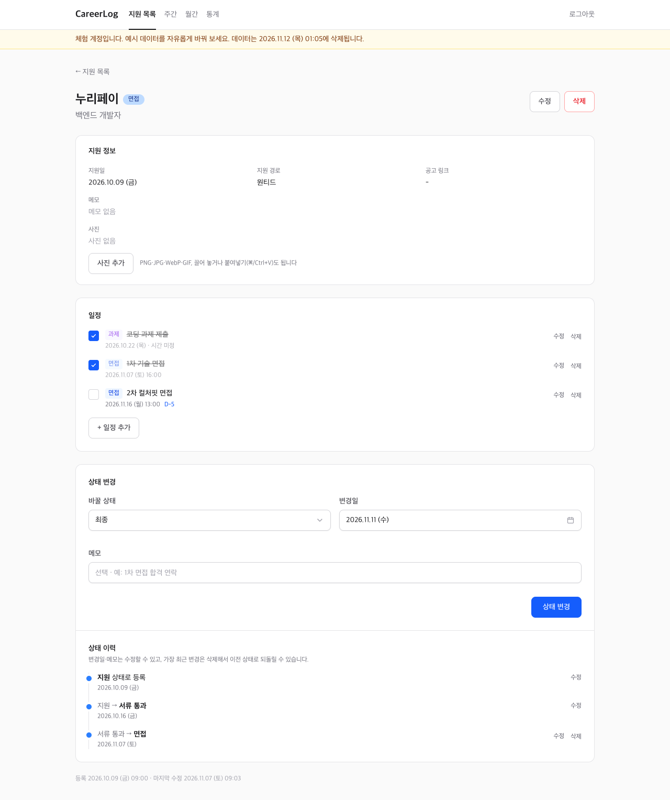
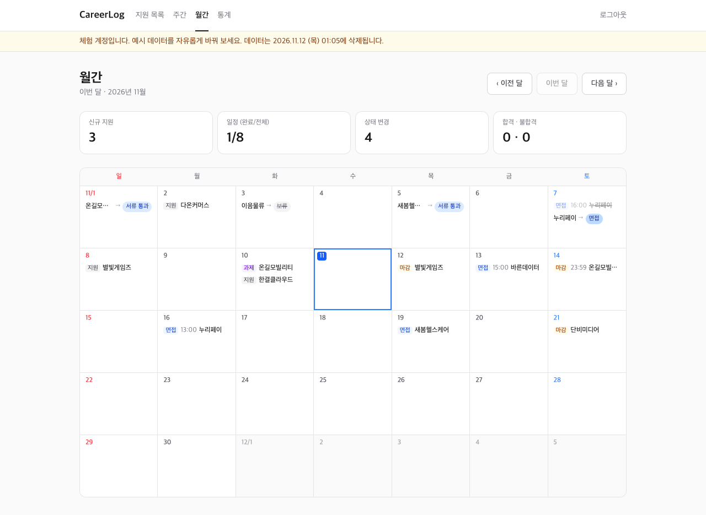

# CareerLog

이직 활동을 기록하는 웹앱입니다. 지원한 회사와 진행 상황, 면접 일정을 한곳에 모으고, 주간·월간 달력과 통계로 흐름을 봅니다.
제가 실제로 이직 준비에 쓰려고 만들었습니다. 기획부터 배포·운영까지 혼자, AI 코딩 에이전트(Claude Code)와 함께 진행했습니다.

**체험해 보기 → https://careerlog-tau.vercel.app**

로그인 화면에서 **체험하기**를 누르면 예시 데이터가 든 체험 공간이 새로 만들어집니다. 방문자마다 따로 만들어지니 마음대로 고쳐 보셔도 됩니다. 24시간이 지나면 자동으로 지워집니다.



## 주요 기능

| 화면 | 내용 |
| --- | --- |
| 지원 목록 | 상태별 필터(관심 → 지원 → 서류 통과 → 면접 → 최종 → 합격/불합격, 보류), 등록·수정·삭제 |
| 상세 | 상태 변경과 변경 이력(날짜·메모 수정, 최근 변경 되돌리기), 면접·과제·마감 일정과 D-day, 사진 첨부(끌어 놓기·붙여넣기, 브라우저에서 축소) |
| 주간 | 지난주·이번 주·다음 주 달력. 항목을 끌어다 놓으면 날짜가 바뀝니다(폰은 길게 눌러 끌기) |
| 월간 | 한 달 달력과 월 요약. 좁은 화면에서는 항목이 있는 날만 목록으로 보여 줍니다 |
| 통계 | 단계별 전환 퍼널, 지금 상태, 지원 경로별 성과, 최근 12주 주별 추이 |

| 주간 | 통계 |
| --- | --- |
|  |  |

| 상세 | 월간 |
| --- | --- |
|  |  |

## 기술 스택

Next.js 16(App Router, Server Actions) · React 19 · TypeScript · Tailwind CSS 4 · Drizzle ORM · PostgreSQL(Neon) · Vercel · Vitest

## 설계에서 신경 쓴 점

**서버 하나, 화면과 데이터 처리를 한 프로젝트에.** 페이지는 서버 컴포넌트에서 DB를 바로 읽고, 쓰기는 Server Actions로 처리합니다. 별도 API 서버 없이 Vercel 한 곳에 배포합니다.

**트랜잭션 없는 드라이버에서 원자성 지키기.** Neon의 HTTP 드라이버는 대화형 트랜잭션을 지원하지 않습니다. 그래서 여러 테이블을 함께 바꾸는 작업은 CTE(`WITH`) 한 문장으로 씁니다([src/db/statements.ts](src/db/statements.ts)). 예를 들어 상태 변경과 이력 기록, 체험 계정과 예시 데이터 생성이 그렇습니다. 서로 독립된 쿼리는 `db.batch`로 묶습니다.

**상태 변경 경로는 하나.** 상태는 한 SQL 문장(`changeStatusWithHistory`)으로만 바뀝니다. 그래서 언제 어떤 상태가 됐는지 이력이 빠짐없이 남고, 통계 퍼널은 이 이력을 기준으로 "도달한 가장 높은 단계"를 셉니다.

**계정 분리.** 원래는 혼자 쓰는 앱이었고, 포트폴리오로 공개하면서 계정 구조를 넣었습니다.
- 지원 건에는 `account_id`를 두고, 이력·일정·사진은 지원 건을 거쳐 계정에 속합니다.
- 모든 조회·변경 함수는 첫 인자로 계정 id를 받습니다. 빠뜨리면 타입 검사에서 걸립니다.
- 다른 계정의 id를 보내면 "없음"(0행, 404)으로 처리합니다.
- 검증은 두 가지로 했습니다.
  - 체험 계정 두 개를 만들고, 한쪽이 다른 쪽 id로 서버 액션을 직접 호출해도 상대 데이터가 바뀌지 않는지 확인했습니다.
  - 같은 호출을 자기 데이터에 보내면 반영되는지도 함께 확인했습니다(대조군).

**라이브러리 없는 차트.** 퍼널·막대·추이 그래프는 HTML과 SVG로 직접 그렸습니다. 말풍선은 마우스와 키보드로 모두 열리고, 모든 그래프에 "표로 보기"가 있습니다.

**날짜는 한국 시간, 일요일 시작.** 날짜 계산은 순수 함수로 분리해 테스트했습니다. 토요일 23:30과 일요일 00:00 같은 주 경계도 테스트에 들어 있습니다. 사진은 Vercel 함수에 디스크가 남지 않아서 DB(bytea)에 저장합니다.

## AI 에이전트와 일한 방식

[AGENTS.md](AGENTS.md)는 에이전트가 작업을 시작할 때 가장 먼저 읽는 파일입니다. 프로젝트 규칙, 겪은 함정, 기능별 진행 기록이 쌓여 있습니다.
- 기능마다 계획을 먼저 세우고 승인받은 뒤 구현했습니다.
- 구현 뒤에는 `pnpm check`(lint·타입·단위 테스트)와 headless Chrome E2E로 확인했습니다. E2E에서는 화면의 숫자를 SQL로 직접 계산한 값과 대조했습니다.
- 운영 DB 마이그레이션은 사람이 직접 적용합니다.

기획은 [docs/PLAN.md](docs/PLAN.md)에 있습니다.

## 로컬에서 실행

```bash
pnpm install
cp .env.example .env.local   # 윈도우: copy .env.example .env.local
pnpm gen:secret              # 출력값을 SESSION_SECRET에
pnpm db:migrate
pnpm dev
```

| 명령 | 내용 |
| --- | --- |
| `pnpm dev` | 개발 서버 (준비되면 브라우저를 엽니다) |
| `pnpm check` | lint + 타입 검사 + 테스트 |
| `pnpm db:generate` / `pnpm db:migrate` | 마이그레이션 생성 / 적용 |
